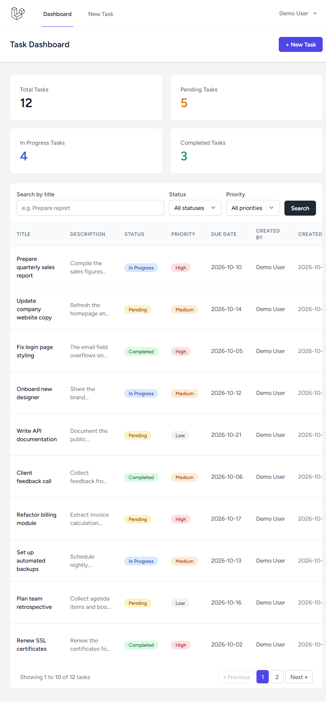
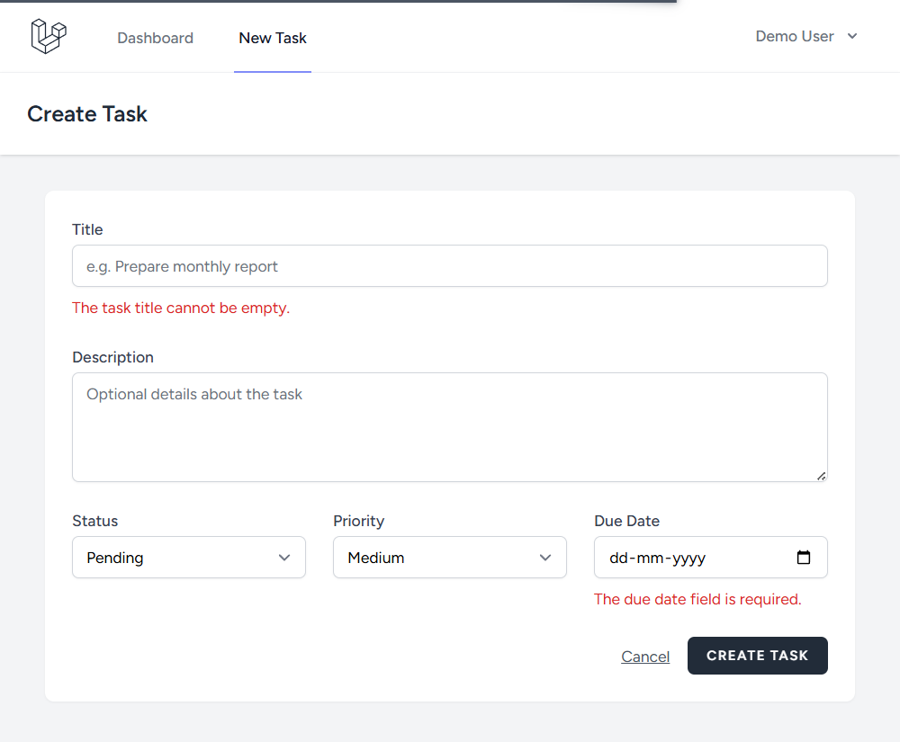
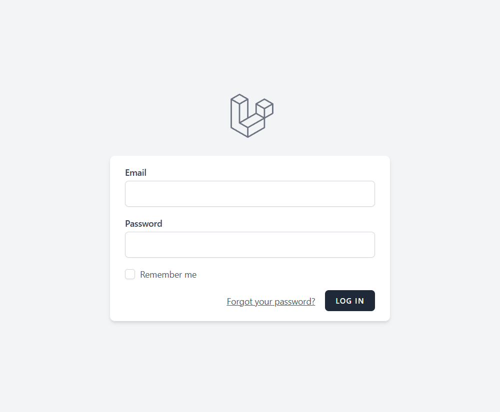
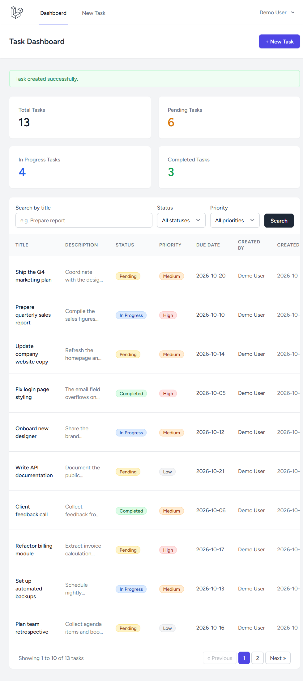
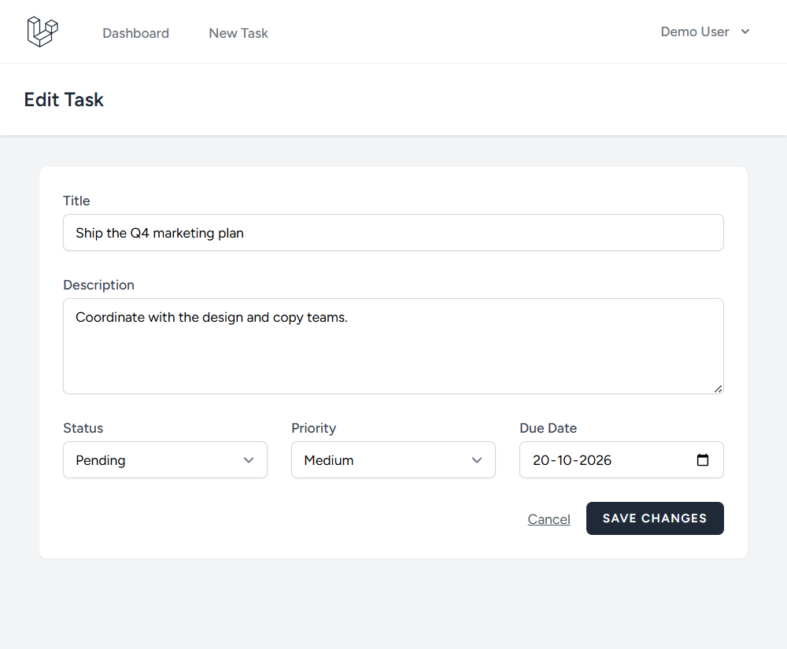
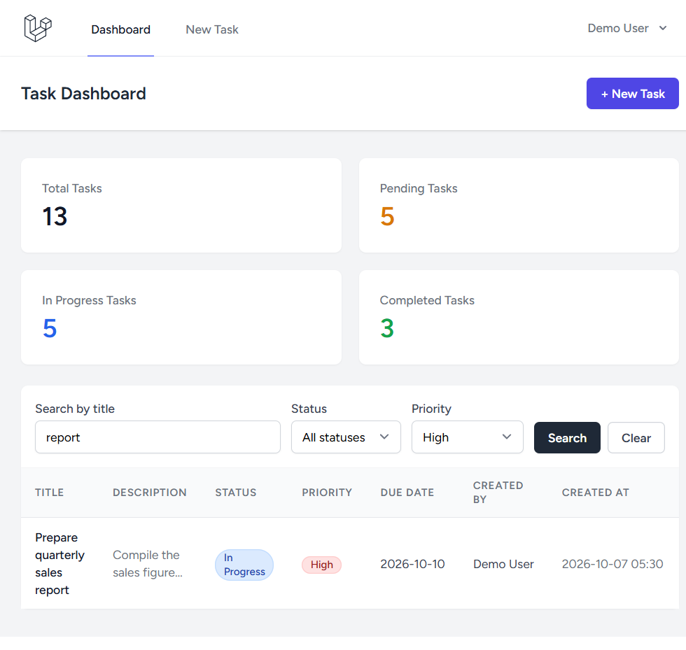

# Task Manager — Laravel + React (Inertia.js)

A simple task management application with authentication. Registered users get a
personal dashboard showing task statistics and can create, view, edit, delete,
complete, search and filter their own tasks.



---

## 1. What the application does

**Authentication (Laravel Breeze starter kit)**

- Register, Login, Logout
- Password reset and profile management (provided by Breeze)
- The task dashboard is only reachable by authenticated users (`auth` middleware)

**Task management**

- Create a task (title, description, status, priority, due date)
- View all of your tasks in a paginated table
- Edit a task
- Delete a task
- Mark a task as completed (and reopen it) with one click
- Every task stores: **Title, Description, Status, Priority, Due Date,
  Created By (the owning user) and Created At**

**Dashboard statistics (React, fed by Laravel)**

- Total Tasks · Pending Tasks · In Progress Tasks · Completed Tasks

**Search & filtering**

- Search tasks by title
- Filter by status (Pending / In Progress / Completed)
- Filter by priority (Low / Medium / High)
- Filters are combined, stored in the query string, and applied by Laravel

**Allowed values**

| Field    | Allowed values                              |
| -------- | ------------------------------------------- |
| Status   | `pending`, `in_progress`, `completed`       |
| Priority | `low`, `medium`, `high`                     |

**Validation rules**

- Title is required and cannot be empty
- Title may not exceed 255 characters
- Status must be one of the allowed statuses
- Priority must be one of the allowed priorities
- Due date is required and must be a valid date
- Description is optional (max 2000 characters)

Errors returned by Laravel are displayed inline in the React forms through
Inertia's `errors` object.



---

## 2. Technologies used

| Layer     | Technology |
| --------- | ---------- |
| Backend   | PHP 8.3, Laravel 12 |
| Frontend  | React 18 (JSX) + Inertia.js (`inertiajs/inertia-laravel`, `@inertiajs/react`) |
| Auth      | Laravel Breeze (React starter kit) |
| Database  | MySQL 8.4, Eloquent ORM, Laravel migrations |
| Styling   | Tailwind CSS |
| Build     | Vite, Laravel Pint (code style) |

---

## 3. How to install it

Prerequisites: **PHP ≥ 8.2**, **Composer**, **Node.js ≥ 20**, **MySQL ≥ 8.0**.

```bash
# 1. Clone the repository
git clone https://github.com/<your-username>/<repo-name>.git
cd <repo-name>

# 2. Install PHP dependencies
composer install

# 3. Install JS dependencies
npm install
```

### 4. How to configure the `.env`

```bash
# 4. Create your environment file and generate an application key
cp .env.example .env
php artisan key:generate
```

Then edit the database section of `.env` to match your MySQL instance:

```dotenv
APP_NAME="Task Manager"
APP_ENV=local
APP_URL=http://localhost

DB_CONNECTION=mysql
DB_HOST=127.0.0.1
DB_PORT=3306
DB_DATABASE=task_manager
DB_USERNAME=taskapp
DB_PASSWORD=your_mysql_password
```

Create the database (and a user with access to it) in MySQL:

```sql
CREATE DATABASE task_manager CHARACTER SET utf8mb4 COLLATE utf8mb4_unicode_ci;
CREATE USER 'taskapp'@'localhost' IDENTIFIED BY 'your_mysql_password';
GRANT ALL PRIVILEGES ON task_manager.* TO 'taskapp'@'localhost';
FLUSH PRIVILEGES;
```

> `.env` is git-ignored on purpose — never commit passwords, API keys or the
> `.env` file itself. Only `.env.example` (without secrets) is tracked.

### 5. How to migrate the database

```bash
# Run all migrations (creates users, cache, jobs and tasks tables)
php artisan migrate

# Optional: seed a demo user + 12 sample tasks
php artisan db:seed
```

Demo credentials after seeding:

```
Email:    demo@example.com
Password: password
```

### 6. How to run the application

```bash
# Terminal 1 — Laravel dev server (http://localhost:8000)
php artisan serve

# Terminal 2 — Vite dev server (hot reloading for React assets)
npm run dev
```

For a production-style build use `npm run build` instead of `npm run dev`
(the repository ships without `public/build`, so assets must be built once).

Open <http://localhost:8000>, register a new account (or log in with the demo
account) and you will land on the task dashboard.

---

## Screenshots

| | |
| :---: | :---: |
|  |  |
| **Login** | **Dashboard with stats, search and filters** |
|  |  |
| **Server-side validation errors** | **Task created (flash message + new stats)** |
|  |  |
| **Edit task form (prefilled)** | **Search + priority filter applied** |

---

## Database design

```
users                          tasks
----                           ----
id            (PK)             id             (PK)
name                           user_id        (FK -> users.id, cascade delete)
email                          title          (varchar 255)
password                       description    (text, nullable)
remember_token                 status         (varchar, indexed, default 'pending')
email_verified_at              priority       (varchar, indexed, default 'medium')
created_at / updated_at        due_date       (date)
                               created_at / updated_at
```

Relationship: **a task belongs to a user** (`Task::user()`), and a user has many
tasks (`User::tasks()`). Deleting a user cascades and deletes their tasks.
Both tables are created exclusively by Laravel migrations
(`database/migrations/...`), never by hand in phpMyAdmin.

### Main routes

| Method | URI | Name | Description |
| ------ | --- | ---- | ----------- |
| GET  | `/dashboard` | `dashboard` | Task dashboard (stats, search, filters, list) |
| GET  | `/tasks/create` | `tasks.create` | Create form |
| POST | `/tasks` | `tasks.store` | Store a new task |
| GET  | `/tasks/{task}/edit` | `tasks.edit` | Edit form |
| PUT  | `/tasks/{task}` | `tasks.update` | Update a task |
| PATCH | `/tasks/{task}/toggle` | `tasks.toggle` | Mark completed / reopen |
| DELETE | `/tasks/{task}` | `tasks.destroy` | Delete a task |
| POST | `/login`, `/register`, `/logout` | Breeze auth routes | Authentication |

All task routes are behind the `auth` middleware and are scoped to the
authenticated user — a user receives a 404 for another user's task.

### React ⇄ Laravel communication

The React pages under `resources/js/Pages/Tasks/` are rendered by
`TaskController` through `Inertia::render()`. Filters are sent as query string
parameters (`/dashboard?search=report&priority=high`), validated and applied by
Laravel with query scopes (`search()`, `status()`, `priority()`), and the
paginated result plus the counters are handed back to React as Inertia props.
Mutations use Inertia's `useForm()` (`post`/`put`/`delete`/`patch`), so
validation errors arrive in the React components without an API layer.

---

## 7. Assumptions & limitations

- **One user sees only their own tasks.** Sharing/assigning tasks between users
  is out of scope, so `created_by` is the owning user (`tasks.user_id`).
- **Due date is required.** Overdue tasks are not visually highlighted yet.
- **Single assignee, no subtasks, comments, attachments or due-date reminders.**
- **Server-side pagination (10 rows per page)**; sorting is fixed to newest
  first (`created_at` descending).
- **Search matches the title only** (case-insensitive `LIKE`), not the
  description, as specified in the brief.
- **No email verification / queues / notifications** are required for the core
  flow; Breeze's default scaffolding is kept as-is.
- **Local development setup**: MySQL 8.x on `127.0.0.1:3306`, app served with
  `php artisan serve`. For production you would use a real web server,
  `APP_ENV=production`, `APP_DEBUG=false` and a built Vite bundle.
- The seed data and the demo account exist only for demonstration purposes.
